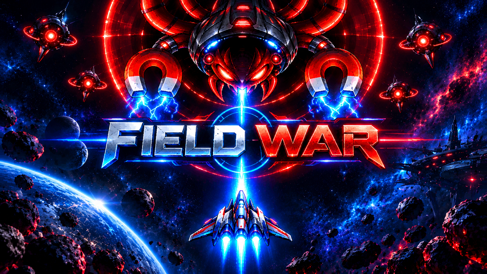

<h1 align="center">🚀 FIELD WAR</h1>

<h3 align="center">ONE MISSION. ONE BATTLEFIELD. NO SECOND CHANCES.</h3>

<p align="center">
  
  
  
  
</p>

<p align="center">
  <a href="https://github.com/matheusrooliveira/Field_War">
    
  </a>
</p>

---

## 🌌 ABOUT THE PROJECT

**FieldWar** is a 2D space shooter game developed in Python using Pygame Community Edition.

In a hostile universe filled with unknown enemies, players must pilot their spacecraft, survive increasingly challenging battles, eliminate enemy forces and face powerful bosses.

The project combines classic arcade gameplay with player authentication, score tracking, database integration and a ranking system.

Developed as an academic team project, FieldWar applies programming and software engineering concepts in the creation of an interactive gaming experience.

## 🎮 GAME FEATURES

- **Player Login:** player identification before starting a game.
- **Main Menu:** navigation and game initialization.
- **Spacecraft Movement:** player-controlled spaceship.
- **Combat System:** shooting mechanics and enemy elimination.
- **Enemy AI:** enemy movement and combat behavior.
- **Boss Battles:** special encounters with powerful enemies.
- **Power-ups:** special items to improve gameplay.
- **Health System:** player lives and survival mechanics.
- **Game Timer:** five-minute gameplay sessions.
- **Scoring System:** points earned during combat.
- **Leaderboard:** player records stored using SQLite.
- **Victory and Game Over:** game state management.

## 🕹️ CONTROLS

| Key | Action |
|---|---|
| W / ↑ | Move up |
| A / ← | Move left |
| S / ↓ | Move down |
| D / → | Move right |
| SPACE | Shoot |
| R | Restart the game |

## 🛠️ TECHNOLOGIES

| Technology | Purpose |
|---|---|
| Python | Main programming language |
| Pygame CE | Game development and graphics |
| SQLite | Database management |
| Git | Version control |
| GitHub | Repository hosting and collaboration |
| Jira | Agile project management |

## 📂 PROJECT STRUCTURE

```text
Field_War/
│
├── assents/
│   └── banner-fieldwar.png
│
├── sistemas/
│   ├── login.py
│   ├── ranking.py
│   └── timer.py
│
├── main.py
├── menu.py
├── player.py
├── enemy.py
├── bullet.py
├── boss.py
├── powerup.py
│
├── requirements.txt
└── README.md
```

## ⚙️ HOW TO RUN

### Requirements

- Python 3.12 or later.
- Git.
- Pygame Community Edition.

### 1. Clone the repository

```bash
git clone https://github.com/matheusrooliveira/Field_War.git
```

### 2. Enter the project directory

```bash
cd Field_War
```

### 3. Create a virtual environment

```bash
python -m venv venv
```

### 4. Activate the environment

**Windows:**

```bash
venv\Scripts\activate
```

### 5. Install dependencies

```bash
pip install -r requirements.txt
```

### 6. Start the game

```bash
python main.py
```

## 🧠 DEVELOPMENT CONCEPTS

Throughout development, the project explores practical software engineering concepts, including:

- Object-Oriented Programming (OOP).
- Modular code architecture.
- Algorithms and programming logic.
- Collision detection and event handling.
- Game state management.
- Database integration and data persistence.
- Version control and collaborative development.
- Agile methodologies and Scrum practices.

## 🚧 FUTURE IMPROVEMENTS

- Soundtracks and sound effects.
- New enemy types and combat mechanics.
- Improved visual effects and animations.
- Expanded gameplay and difficulty progression.
- Interface and user experience improvements.

## 👥 DEVELOPMENT TEAM

FieldWar is an academic project developed collaboratively as part of the Computer Science program.

The team uses GitHub for version control and Jira for task management, planning and sprint organization.

## 📌 PROJECT INFORMATION

**Repository:** [github.com/matheusrooliveira/Field_War](https://github.com/matheusrooliveira/Field_War)

**Category:** 2D Space Shooter

**Language:** Python

**Framework:** Pygame Community Edition

---

<p align="center">
  
</p>

<h3 align="center">🌠 FIELD WAR</h3>

<p align="center">
  <i>Survive the battlefield. Defeat the unknown. Become the legend.</i>
</p>

<p align="center">
  <b>GAME OVER IS NOT AN OPTION.</b>
</p>
