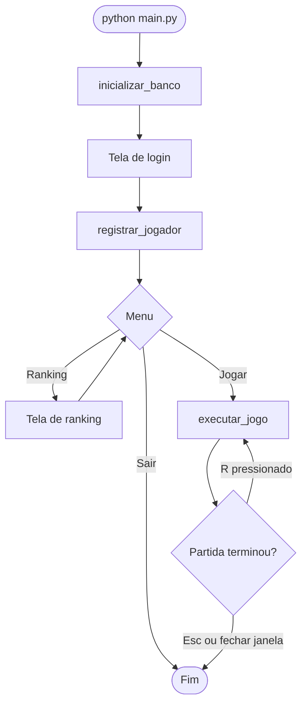
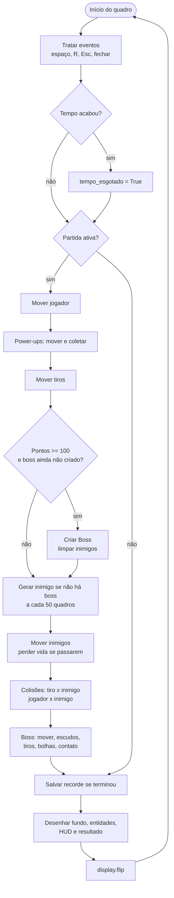
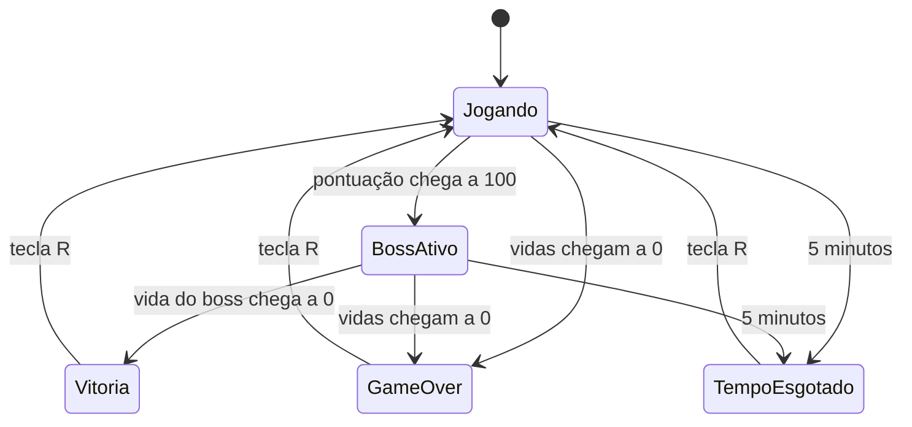

# Ciclo do jogo

## Fluxo geral do programa

## Um quadro da partida (60 por segundo)

A cada iteração de `executar_jogo()`, nesta ordem:

## Estados da partida

O estado é representado por flags booleanas no dicionário `estado` (`boss_ativado`, `game_over`, `vitoria`, `tempo_esgotado`). Enquanto qualquer uma das três flags finais está ativa, o gameplay é congelado, mas a tela continua sendo desenhada.

## Detecção de colisão

Todas as entidades possuem um `pygame.Rect` (`rect`) atualizado a cada movimento. As colisões usam `Rect.colliderect()`, com exceção dos **escudos do Boss**, que usam distância euclidiana (`math.hypot`) entre o tiro e o centro de cada escudo.

## Persistência do resultado

Quando a partida termina, `salvar_resultado()` grava o recorde uma única vez (controle pela flag `recorde_salvo`). O tempo gasto é calculado como `300 - tempo_restante`.
