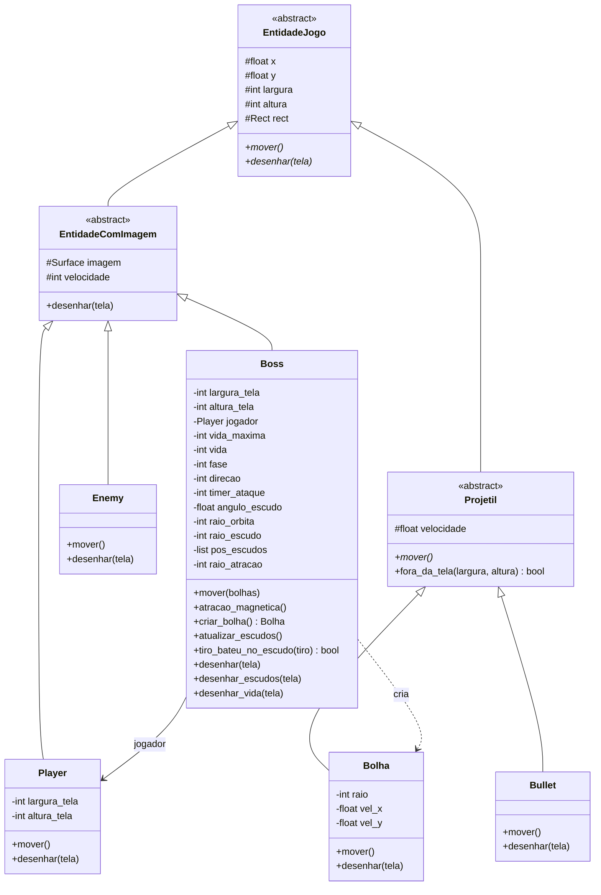
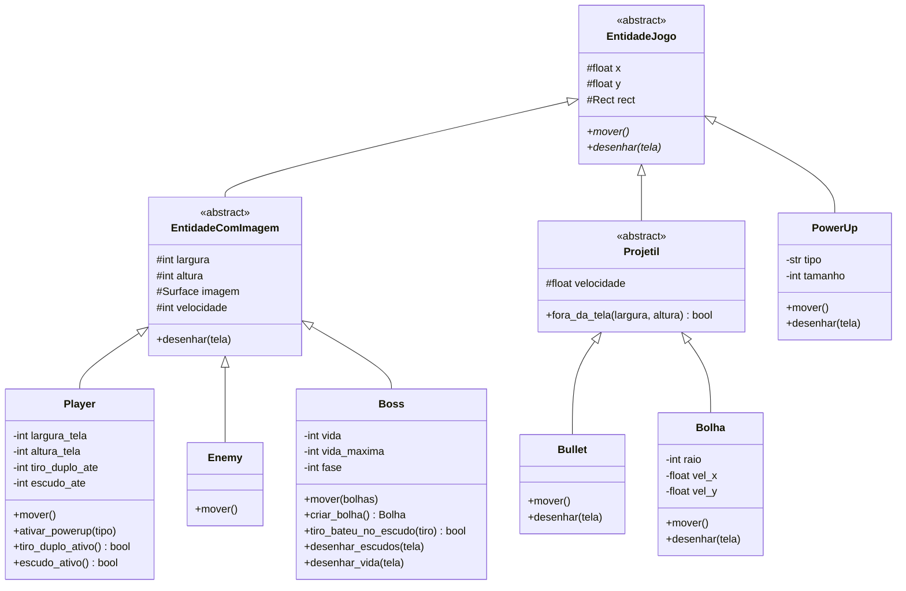
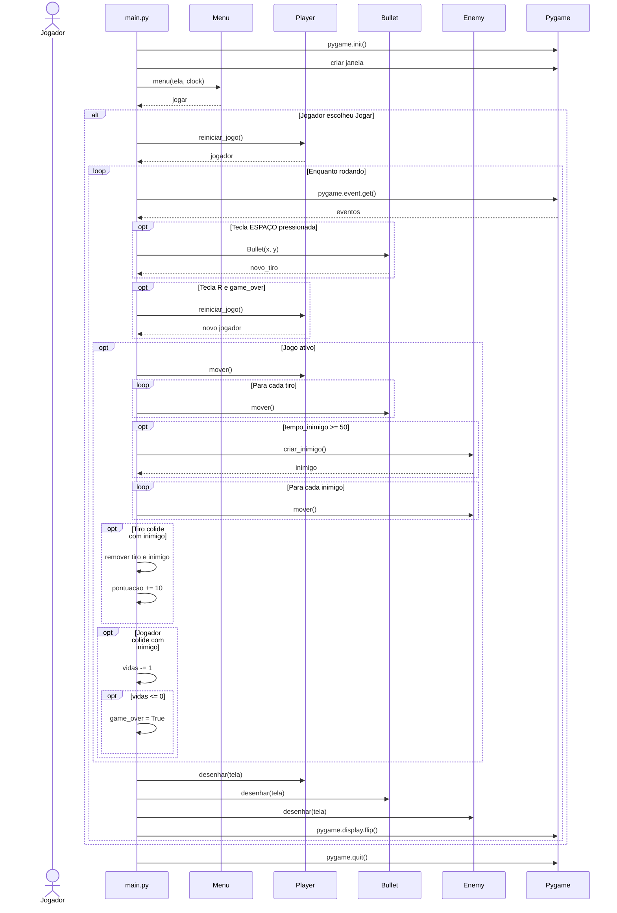

# Diagramas UML

Os diagramas do projeto foram escritos em **PlantUML** (pasta `Diagramas/` do repositório). Esta página mostra versões renderizadas em Mermaid e, em cada seção, o código-fonte PlantUML original para quem quiser gerar as imagens.

:::caution Diagramas x código atual
Os diagramas descrevem um modelo orientado a objetos com classes-base abstratas (`EntidadeJogo`, `EntidadeComImagem` e `Projetil`). No código atual (`player.py`, `enemy.py`, `boss.py`, `bullet.py`, `bolha.py` e `powerup.py`), **essas classes-base ainda não existem**: cada classe é declarada de forma independente (`class Player:`), sem herança, e repete atributos como `x`, `y` e `rect`. Os diagramas servem como **modelo de design** e roteiro de refatoração. Veja também [Melhorias futuras](../melhorias-futuras.md).
:::

## Diagrama de classes



<details>
<summary>Código-fonte PlantUML (<code>diagrama_classes.puml</code>)</summary>

```text
@startuml
title Diagrama de Classes - FIELD WAR
skinparam classAttributeIconSize 0
skinparam shadowing false
skinparam classBackgroundColor #F8F9FF
skinparam ArrowColor #333333

abstract class EntidadeJogo {
  # x : float
  # y : float
  # largura : int
  # altura : int
  # rect : pygame.Rect
  + {abstract} mover()
  + {abstract} desenhar(tela)
}

abstract class EntidadeComImagem {
  # imagem : pygame.Surface
  # velocidade : int
  + desenhar(tela)
}

abstract class Projetil {
  # velocidade : float
  + {abstract} mover()
  + fora_da_tela(largura, altura) : bool
}

class Player {
  - largura_tela : int
  - altura_tela : int
  + mover()
  + desenhar(tela)
}

class Enemy {
  + mover()
  + desenhar(tela)
}

class Boss {
  - largura_tela : int
  - altura_tela : int
  - jogador : Player
  - vida_maxima : int
  - vida : int
  - fase : int
  - direcao : int
  - timer_ataque : int
  - angulo_escudo : float
  - raio_orbita : int
  - raio_escudo : int
  - pos_escudos : list
  - raio_atracao : int
  + mover(bolhas)
  + atracao_magnetica()
  + criar_bolha() : Bolha
  + atualizar_escudos()
  + tiro_bateu_no_escudo(tiro) : bool
  + desenhar(tela)
  + desenhar_escudos(tela)
  + desenhar_vida(tela)
}

class Bullet {
  + mover()
  + desenhar(tela)
}

class Bolha {
  - raio : int
  - vel_x : float
  - vel_y : float
  + mover()
  + desenhar(tela)
}

EntidadeJogo <|-- EntidadeComImagem
EntidadeJogo <|-- Projetil
EntidadeComImagem <|-- Player
EntidadeComImagem <|-- Enemy
EntidadeComImagem <|-- Boss
Projetil <|-- Bullet
Projetil <|-- Bolha

Boss --> "1" Player : jogador
Boss ..> Bolha : <<cria>>
@enduml
```

</details>

## Hierarquia de herança

Mostra a árvore de herança proposta, incluindo `PowerUp` e os atributos de power-up do `Player`.



<details>
<summary>Código-fonte PlantUML (<code>diagrama_heran#U00e7a.puml</code>)</summary>

```text
@startuml
title Hierarquia de Herança - FIELD WAR
skinparam classAttributeIconSize 0
skinparam shadowing false
skinparam classBackgroundColor #F8F9FF
skinparam ArrowColor #333333

abstract class EntidadeJogo {
  # x : float
  # y : float
  # rect : pygame.Rect
  + {abstract} mover()
  + {abstract} desenhar(tela)
}

abstract class EntidadeComImagem {
  # largura : int
  # altura : int
  # imagem : pygame.Surface
  # velocidade : int
  + desenhar(tela)
}

abstract class Projetil {
  # velocidade : float
  + fora_da_tela(largura, altura) : bool
}

class Player {
  - largura_tela : int
  - altura_tela : int
  - tiro_duplo_ate : int
  - escudo_ate : int
  + mover()
  + ativar_powerup(tipo)
  + tiro_duplo_ativo() : bool
  + escudo_ativo() : bool
}

class Enemy {
  + mover()
}

class Boss {
  - vida : int
  - vida_maxima : int
  - fase : int
  + mover(bolhas)
  + criar_bolha() : Bolha
  + tiro_bateu_no_escudo(tiro) : bool
  + desenhar_escudos(tela)
  + desenhar_vida(tela)
}

class Bullet {
  + mover()
  + desenhar(tela)
}

class Bolha {
  - raio : int
  - vel_x : float
  - vel_y : float
  + mover()
  + desenhar(tela)
}

class PowerUp {
  - tipo : str
  - tamanho : int
  + mover()
  + desenhar(tela)
}

EntidadeJogo <|-- EntidadeComImagem
EntidadeJogo <|-- Projetil
EntidadeJogo <|-- PowerUp
EntidadeComImagem <|-- Player
EntidadeComImagem <|-- Enemy
EntidadeComImagem <|-- Boss
Projetil <|-- Bullet
Projetil <|-- Bolha

note right of EntidadeJogo
  Classe base: tudo que existe
  na tela e se move.
end note
@enduml
```

</details>

## Diagrama de sequência

Fluxo principal de uma partida: menu, criação do jogador e laço de eventos, tiros, inimigos e colisões.



:::note
Este diagrama cobre o gameplay básico. Login, power-ups, Boss, bolhas e ranking foram acrescentados depois e aparecem em [Ciclo do jogo](./ciclo-do-jogo.md).
:::

<details>
<summary>Código-fonte PlantUML (<code>sequencia.puml</code>)</summary>

```text
@startuml
title Diagrama de Sequência - FIELD WAR

actor Jogador
participant "main.py" as Main
participant "Menu" as Menu
participant "Player" as Player
participant "Bullet" as Bullet
participant "Enemy" as Enemy
participant "Pygame" as Pygame

Main -> Pygame : pygame.init()
Main -> Pygame : criar janela
Main -> Menu : menu(tela, clock)

Menu --> Main : jogar

alt Jogador escolheu Jogar

    Main -> Player : reiniciar_jogo()
    activate Player
    Player --> Main : jogador
    deactivate Player

    loop Enquanto rodando

        Main -> Pygame : pygame.event.get()
        Pygame --> Main : eventos

        alt Tecla ESPAÇO pressionada
            Main -> Bullet : Bullet(x, y)
            Bullet --> Main : novo_tiro
        end

        alt Tecla R e game_over
            Main -> Player : reiniciar_jogo()
            Player --> Main : novo jogador
        end

        alt Jogo ativo

            Main -> Player : mover()
            Player --> Main

            loop Para cada tiro
                Main -> Bullet : mover()
            end

            alt tempo_inimigo >= 50
                Main -> Enemy : criar_inimigo()
                Enemy --> Main : inimigo
            end

            loop Para cada inimigo
                Main -> Enemy : mover()
                Enemy --> Main
            end

            alt Tiro colide com inimigo
                Main -> Bullet : verificar rect
                Main -> Enemy : verificar rect
                Main -> Main : remover tiro
                Main -> Main : remover inimigo
                Main -> Main : pontuacao += 10
            end

            alt Jogador colide com inimigo
                Main -> Player : verificar rect
                Main -> Enemy : verificar rect
                Main -> Main : vidas -= 1

                alt vidas <= 0
                    Main -> Main : game_over = True
                end
            end

        end

        Main -> Player : desenhar(tela)

        loop Para cada tiro
            Main -> Bullet : desenhar(tela)
        end

        loop Para cada inimigo
            Main -> Enemy : desenhar(tela)
        end

        Main -> Pygame : pygame.display.flip()

    end

end

Main -> Pygame : pygame.quit()

@enduml
```

</details>

## Como gerar as imagens PlantUML

```bash
# com o JAR do PlantUML (requer Java e Graphviz)
java -jar plantuml.jar Diagramas/*.puml

# ou, com a extensão "PlantUML" do VS Code, use Alt+D no arquivo .puml
```
