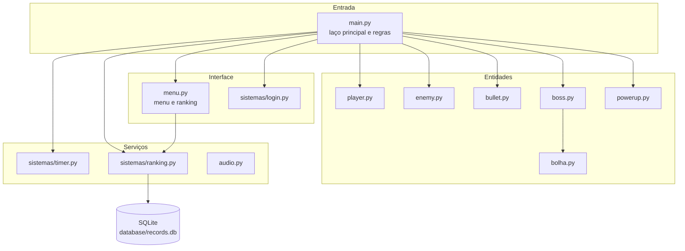

# Estrutura do projeto

```text
Field_War/
│
├── assents/                 # imagens e sons (a pasta chama-se "assents" no projeto)
│   ├── banner-fieldwar.png
│   ├── boss.png
│   ├── nave.png
│   ├── nave_inimiga.png
│   └── sons/                # 17 arquivos .wav (músicas e efeitos)
│
├── Diagramas/               # fontes PlantUML
│   ├── diagrama_classes.puml
│   ├── diagrama_herança.puml
│   └── sequencia.puml
│
├── sistemas/
│   ├── __init__.py
│   ├── login.py             # tela de login
│   ├── ranking.py           # banco SQLite e ranking
│   └── timer.py             # cronômetro da partida
│
├── tools/
│   └── gerar_audio.py       # sintetiza os .wav com numpy
│
├── main.py                  # ponto de entrada e laço principal
├── menu.py                  # menu e tela de ranking
├── player.py                # nave do jogador
├── enemy.py                 # inimigos
├── bullet.py                # tiros
├── boss.py                  # chefe
├── bolha.py                 # projétil do boss
├── powerup.py               # itens coletáveis
├── audio.py                 # gerenciador de áudio
│
├── database/                # criada em tempo de execução (records.db)
├── requirements.txt
└── README.md
```

:::note
O banco `database/records.db` não vem no repositório: a pasta e o arquivo são criados automaticamente na primeira execução.
:::

## Organização em camadas



Em resumo: o `main.py` concentra as **regras do jogo** (colisões, pontuação, vidas, condições de fim) e usa as classes de entidade apenas para guardar estado, mover e desenhar.
