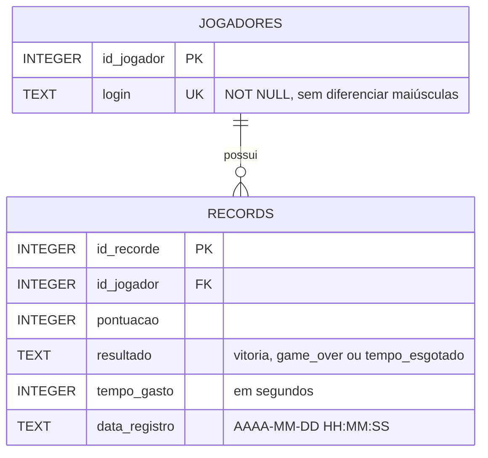

# Banco de dados e ranking

O Field War usa **SQLite** (módulo `sqlite3` da biblioteca padrão do Python) para guardar jogadores e recordes. Todo o acesso está em `sistemas/ranking.py`.

## Localização

O arquivo fica em `database/records.db`, dentro da pasta do projeto. A pasta e as tabelas são criadas automaticamente por `inicializar_banco()`, chamada no início de `main()`.

## Modelo de dados



```sql
CREATE TABLE IF NOT EXISTS jogadores (
    id_jogador INTEGER PRIMARY KEY AUTOINCREMENT,
    login TEXT NOT NULL UNIQUE COLLATE NOCASE
);

CREATE TABLE IF NOT EXISTS records (
    id_recorde INTEGER PRIMARY KEY AUTOINCREMENT,
    id_jogador INTEGER NOT NULL,
    pontuacao INTEGER NOT NULL,
    resultado TEXT NOT NULL,
    tempo_gasto INTEGER NOT NULL,
    data_registro TEXT NOT NULL,
    FOREIGN KEY (id_jogador) REFERENCES jogadores(id_jogador)
);
```

O `login` é `UNIQUE` com `COLLATE NOCASE`: `Igor` e `igor` são o mesmo jogador.

## Funções

| Função | O que faz |
|---|---|
| `conectar()` | Abre uma conexão com `records.db` |
| `inicializar_banco()` | Cria as tabelas, se não existirem |
| `registrar_jogador(login)` | Insere o jogador com `INSERT OR IGNORE` e devolve o `id_jogador` |
| `salvar_recorde(login, pontuacao, resultado, tempo_gasto)` | Registra o jogador (se novo) e grava uma linha em `records` com data e hora atuais |
| `obter_ranking()` | Devolve o Top 10 como lista de tuplas `(login, pontuacao, tempo_gasto)` |

Todas as consultas usam parâmetros (`?`), o que evita SQL injection no login digitado pelo jogador.

## Como o ranking é calculado

O ranking mostra **um único recorde por jogador**: o melhor. A subconsulta escolhe, para cada jogador, o registro com:

1. maior **pontuação**;
2. em caso de empate, menor **tempo gasto**;
3. em caso de novo empate, a **data mais antiga**.

Depois, os melhores recordes de todos os jogadores são ordenados por pontuação (decrescente) e tempo (crescente), limitados a **10 linhas**.

```sql
SELECT jogadores.login, records.pontuacao, records.tempo_gasto
FROM jogadores
INNER JOIN records ON jogadores.id_jogador = records.id_jogador
WHERE records.id_recorde = (
    SELECT r2.id_recorde
    FROM records AS r2
    WHERE r2.id_jogador = jogadores.id_jogador
    ORDER BY r2.pontuacao DESC, r2.tempo_gasto ASC, r2.data_registro ASC
    LIMIT 1
)
ORDER BY records.pontuacao DESC, records.tempo_gasto ASC
LIMIT 10;
```

## Quando um recorde é gravado

Ao final de **toda** partida, seja vitória, Game Over ou tempo esgotado, e apenas uma vez por partida. Como o ranking considera só o melhor recorde de cada jogador, jogar novamente nunca piora a posição.

## Consultando o banco manualmente

```bash
sqlite3 database/records.db "SELECT * FROM records ORDER BY pontuacao DESC;"
```
