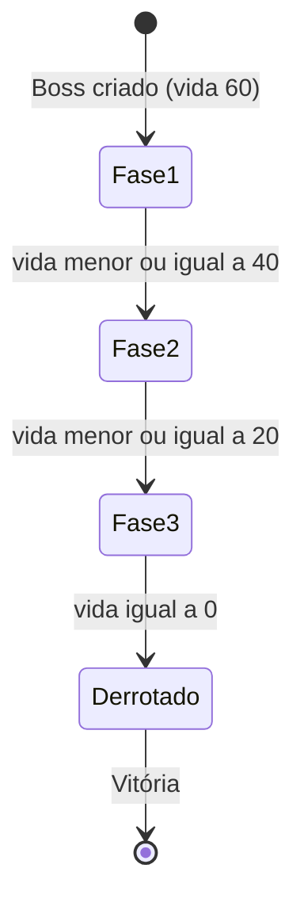

import Sprite from '@site/src/components/Sprite';

# O Boss

  <Sprite arquivo="boss.png" legenda="Boss (220 x 160 px)" />

O Boss aparece quando o jogador chega a **100 pontos**. Ele tem **60 pontos de vida** e cada tiro certeiro tira **1**. A barra de vida (`BOSS  60/60`) é exibida na tela.

## Fases

A fase é definida pela vida restante. Quanto menos vida, mais rápido e agressivo ele fica.

| | Fase 1 | Fase 2 | Fase 3 |
|---|---|---|---|
| Vida restante | mais de 40 | de 21 a 40 | 20 ou menos |
| Velocidade horizontal | 3 | 5 | 7 |
| Intervalo entre ataques | 90 quadros | 60 quadros | 35 quadros |
| Força da atração magnética | 2,0 | 3,5 | 5,0 |
| Escudos orbitais | não | **sim** | **sim** |

## Movimento

O Boss se move na horizontal de uma borda à outra, invertendo a direção ao tocar nas laterais. Na vertical ele oscila suavemente em torno de y = 50 (uma onda senoidal de amplitude 15).

## Ataque: bolhas

A cada intervalo de ataque, o Boss lança uma **bolha** (raio de 12 pixels, velocidade 3,5) na direção **da posição atual do jogador**. A bolha segue em linha reta e some ao sair da tela. Se acertar a nave, tira 1 vida.

## Atração magnética

Se o jogador estiver a menos de **450 pixels** do Boss, a nave é **puxada** em direção a ele a cada quadro, com a força da fase atual. É preciso compensar o puxão com o movimento.

## Escudos orbitais

A partir da **fase 2**, dois escudos giram em torno do Boss (raio de órbita de 150 pixels, 180 graus de diferença entre eles). Qualquer tiro que passe a menos de **55 pixels** do centro de um escudo é absorvido e não causa dano. O jogador precisa atirar pelas brechas entre os escudos.

## Estratégia

1. Na fase 1, fique afastado para reduzir a atração e dispare de longe.
2. Na fase 2, observe o giro dos escudos e atire quando houver brecha.
3. Na fase 3, o puxão é 2,5 vezes mais forte que na fase 1 e os ataques são frequentes: mova-se o tempo todo.
4. Novos power-ups só caem de **inimigos destruídos**, e eles deixam de aparecer quando o Boss entra. Chegue ao Boss com vidas sobrando e aproveite os power-ups que ainda estiverem caindo.
